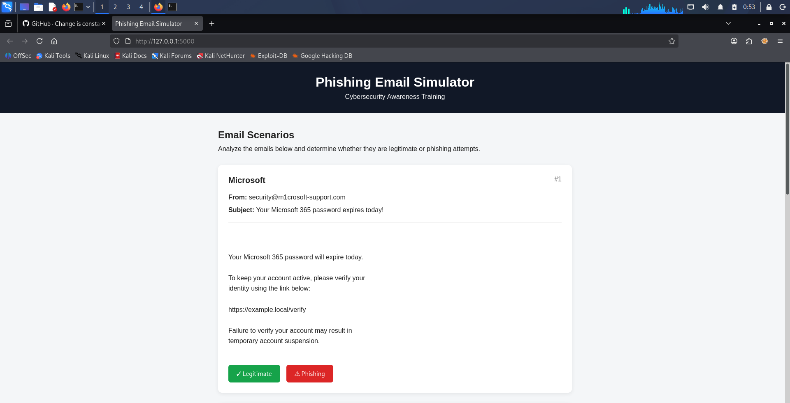
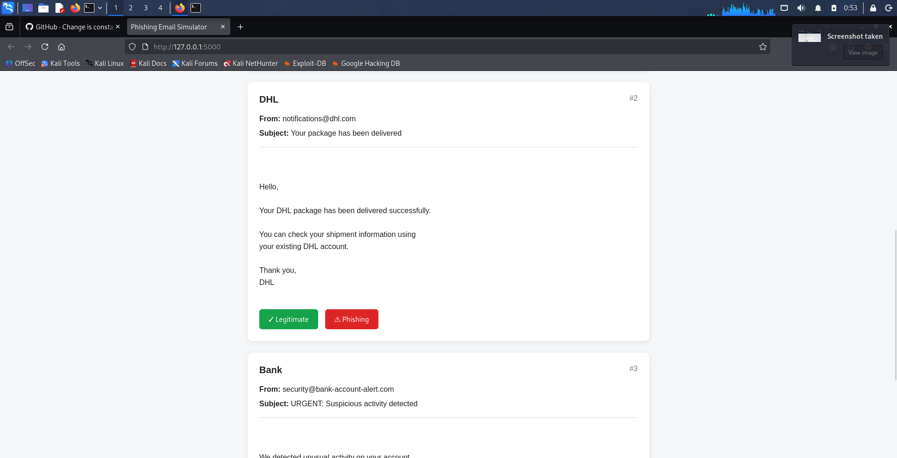
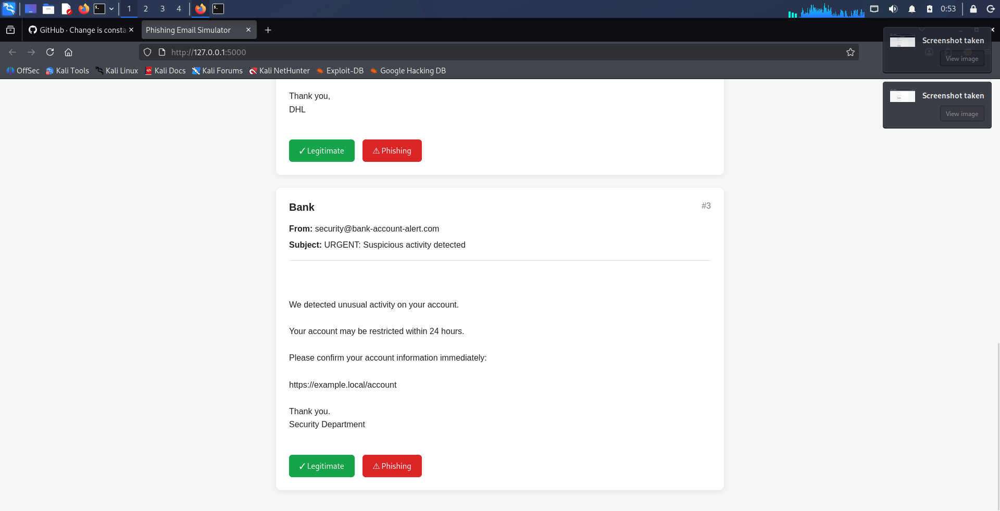
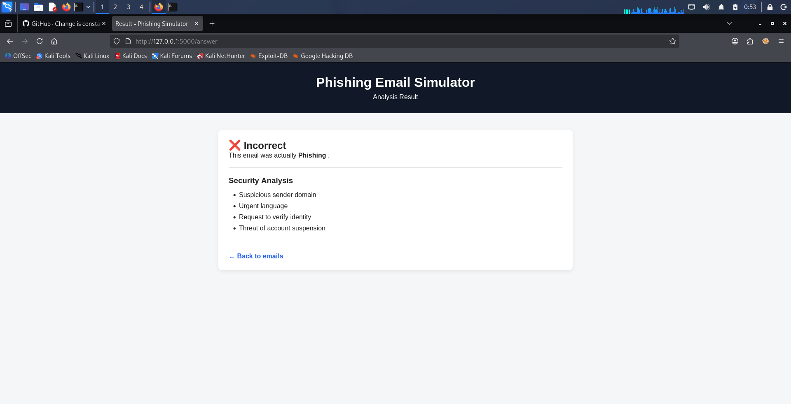
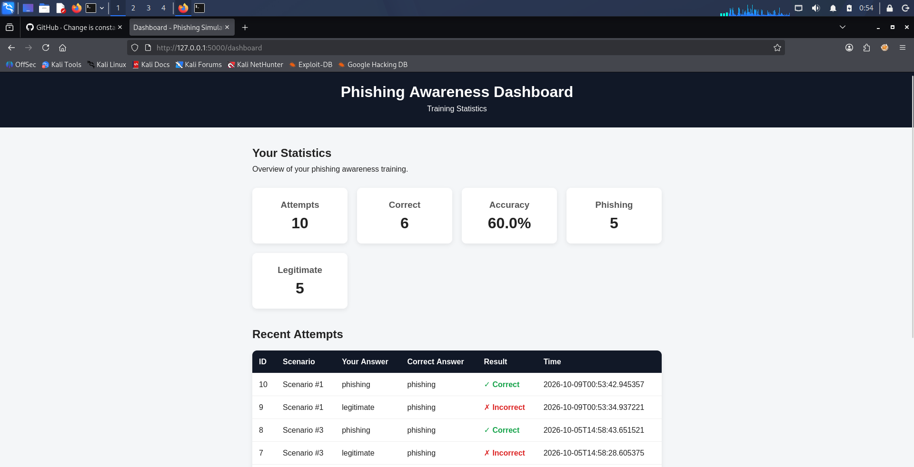

# Phishing Email Simulator

A small web application I built to practice Python, Flask, SQLite and some basic cybersecurity concepts.

The idea is simple: the user gets different email examples and has to decide whether an email is **phishing** or **legitimate**.

I made this project as part of my personal IT/cybersecurity portfolio.

## What it can do

- Shows different email scenarios
- Lets the user choose between Phishing and Legitimate
- Shows whether the answer was correct
- Explains some of the phishing indicators
- Saves attempts in a SQLite database
- Keeps track of basic statistics
- Has a simple dashboard for previous attempts

## Technologies

- Python
- Flask
- SQLite
- HTML
- CSS
- Jinja2

## How it works

The emails are stored as Python data in `simulator/emails.py`.

When the application starts, Flask loads these scenarios and displays them on the website.

When the user chooses an answer, the browser sends a POST request to Flask. Flask checks the answer and saves the result in the SQLite database.

The basic flow is:

```text
Email
  ↓
User chooses an answer
  ↓
Flask processes the answer
  ↓
Answer is checked
  ↓
Result is saved to SQLite
  ↓
Result is shown to the user
```

## Example scenarios

The simulator currently contains three example scenarios.

### Microsoft

A fake Microsoft security email with a suspicious sender domain, urgent language and a request to verify the account.

### DHL

A legitimate email used as a comparison with the phishing examples.

### Bank

A simulated bank security email using urgency, a suspicious domain and a request for account information.

The emails are only simulations. They don't send anything and don't collect real credentials.

## Project structure

```text
phishing-email-simulator/
│
├── app.py
├── database.py
├── main.py
├── requirements.txt
├── README.md
│
├── simulator/
│   ├── __init__.py
│   ├── analyzer.py
│   ├── emails.py
│   └── statistics.py
│
├── templates/
│   ├── index.html
│   ├── result.html
│   └── dashboard.html
│
└── static/
    └── style.css
```

The SQLite database is created locally and is not included in the repository.

## Running the project

Clone the repository:

```bash
git clone https://github.com/YOUR_USERNAME/phishing-email-simulator.git
cd phishing-email-simulator
```

Create a virtual environment:

```bash
python3 -m venv venv
source venv/bin/activate
```

Install the dependencies:

```bash
pip install -r requirements.txt
```

Start the application:

```bash
python app.py
```

Then open:

```text
http://127.0.0.1:5000
```

## What I learned

While making this project I learned more about how a small web application works.

In particular, I practiced:

- Python functions and modules
- Flask routes
- HTML forms
- POST requests
- Jinja2 templates
- SQLite and SQL queries
- Saving data to a database
- Debugging Python/Flask applications
- Basic phishing and social-engineering concepts

One thing I found useful was seeing how the frontend and backend communicate:

```text
HTML
 ↓
POST request
 ↓
Flask
 ↓
Python
 ↓
SQLite
```

## Possible improvements

There are still some things I would like to improve later:

- Add more scenarios
- Add difficulty levels
- Improve the dashboard
- Add charts
- Add more detailed phishing analysis
- Add automated tests

## Disclaimer

This project is for learning and cybersecurity awareness purposes.

The emails are simulated and the application does not send real phishing emails or collect real passwords.

## Screenshots

### Main Page







### Analysis Result




### 




